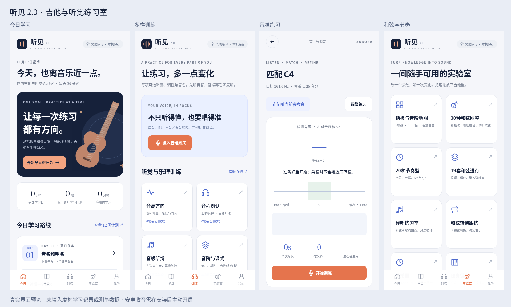

# 听见 2.0 · 吉他与听觉练习室

根据用户提供的三份学习网页重写的中文安卓应用，把知识、每日任务、听觉训练、指板与弹唱练习整合在同一个离线工作流中。

**[下载安卓 2.0 测试版](https://github.com/Zhuzhu-Jie/sonora-music/blob/main/downloads/v2.0.0/sonora-2.0.0.apk)** · [查看发布说明](https://github.com/Zhuzhu-Jie/sonora-music/releases/tag/v2.0.0)

仓库为私有仓库，需要先登录有权限的 GitHub 账号。打开 APK 文件页，点击 **Download raw file / View raw** 下载，传到安卓手机打开安装。文件放在仓库 `downloads/v2.0.0/` 目录，发布页提供说明和下载链接；不必进入云开发环境。



## 这次重写了什么

- **57章课程**：43章吉他弹唱百科与14章乐理手册，保留图解、例子、练法、验收标准、章节自测和24道阶段思考题。
- **3条计划**：12周84天吉他乐理、6周42天听音专项、14天弹唱路线。任务、自评、笔记和日期可记录，所有章节和训练始终开放。
- **8类听觉与乐理训练**：音高方向、13种音程、音级、8种音阶/调式、9类和弦性质、19套和声进行、3–6音短句听写、基础概念与随机指板自测。
- **可调整的听辨**：难度、参考调/随机换调、拨弦/琴音/纯音、上行/下行/同时发声、题数；和弦题可选琶音与挑战转位。今日听音任务会带入重点。
- **错题复练**：保存实际音高关系与呈现条件；复练连续两次答对标记已掌握。可看解析、复听，不在听题前透露实际答案。
- **屏幕节奏敲击**：20种节奏型可跟拍或听后模仿，支持3/4与6/8；计时预备拍、命中、额外点击和时间误差。额外乱点会降低得分，中断练习不记成完成。
- **音准与调音**：单音匹配、三音/五音分段模唱、吉他六弦标准调音。显示频率、音名、音分和有效采样统计。分段模唱需在容差内稳定至少0.8秒且有足够连续采样，再手动进入下一个音。
- **指板练习**：6弦0–12品，共78个可点选位置，可换主音和音阶；另有不提前显示音名的指板找音训练。
- **弹唱工具**：30种指法图、20种节奏、19套可移调循环、两和弦转换跟练、分层弹唱室。支持自定义和弦/歌词拍点、变调夹、速度、节奏和最多30张本机编配曲卡。
- **其他声音工具**：节拍器、三组音区的逐音键盘、24组固定音高示范。安装包另包含既有的68个合成WAV音符及教学素材；动态训练在本机实时合成，不依赖网络。

## 安装和升级

最低 Android 8.0（API26），编译/目标 API35。建议使用已更新的系统 WebView。

2.0 与原1.0使用相同包名 `cn.sonora.music` 和相同签名，版本号提升为200，可直接覆盖安装，正常情况下无需卸载。卸载会清除应用数据。新版使用独立的2.0记录结构；旧版 localStorage 未清除，旧版笔记和摘要数量可在“我的 → 查看1.0旧版记录”查看。若手机没有旧版数据，该处显示为空。

新签名自行重编译的APK不能覆盖本次交付版本；维护自己的签名或使用同一开发签名才可继续覆盖更新。发布私钥和密码没有上传到GitHub。

## 怎样开始练

1. **今日**：打开当天任务，读核心章节，在指板或声音中验证，达到验收标准后自行勾选。
2. **训练**：选择模式与难度，完整听题后再作答。错题有声音关系解析，可以再听；文字自测不需要播放。
3. **实验室**：改变调或节奏，听和弦进行，再将其送入弹唱室。默认歌词为原创节奏朗读示例，不是正式旋律谱；需要你自己读词/演唱，应用只提供合成伴奏和拍点。
4. **我的**：查看实际练习摘要、错题薄弱项和笔记。通过系统文件选择器导出JSON备份，换设备前保留一份。

## 分数的含义与限制

- 音高按A4=440Hz、十二平均律估计。正音分偏高，负音分偏低；±25或±15音分只是本应用练习容差，不是统一专业标准。
- 声音在内存中检测。至少10个有效采样才保存单音摘要。静音、声音不足和不稳定周期性不当作有效音高，不生成虚构成绩。目标相差八度会显示约±1200音分；图表刻度只显示±100，实际估计数值以文字为准。
- 分段模唱测量逐个目标的匹配，不等于连续旋律或整曲评分。调音器适合安静环境中的单根弦，不适合和弦或多人声。
- 屏幕敲击分数来自点击时间，包含触屏和系统延迟，不代表真实扫弦水平。和弦转换与弹唱室只记录练习时长，不对未检测的演奏生成准确率。
- 和声听辨会先建立主和弦/主音参照；转位、借用和弦与次属和弦保留其真实性质。C7等某些吉他按法会省略五音，图鉴区分理论组成与实际发声。
- 全部音频为内置或实时合成示范，不是真实教师演奏、人声或商业歌曲。未授权收录任何商业歌曲。

## 隐私与本机备份

只声明 **RECORD_AUDIO**，没有 INTERNET、联系人、位置、相册或通用存储权限，没有广告、账号或遥测SDK。录音不保存为文件、不上传，仅在用户主动开始的前台练习期间处理，返回/进入后台停止，单次最长60秒。Native端也设有60秒上限。

导入/导出使用安卓 Storage Access Framework，只读写你选择的文件URI，不扫描其他文件。JSON备份包括任务、笔记、题目与数字摘要、自定义歌词和曲卡，不含声音。限制4MiB；导入校验格式与字段，显示摘要，确认后才替换2.0记录。系统自动备份关闭，卸载或清除存储会丢失本机数据。

界面只加载安装包资源。网络、网页文件读取和外部导航关闭；参考HTML使用白名单净化，不执行上传文件中的脚本；笔记/歌词作为文字显示。版本未经过独立安全审计，不能承诺绝对安全。

## 参考与整合

用户提供：

- `Guitar_Theory_12_Week_Interactive(1).html`
- `音阶辨别能力(3).html`
- `吉他弹唱知识百科_图解课程_节奏和弦实验室(1).html`

只静态解析数据和正文，不运行参考脚本，也不把附件中的指令当作用户要求。导入记录与文件SHA-256见 `docs/reference-import.json`。原网页的浏览器学习记录不包含在HTML文件中，不会凭空出现在安卓应用里。

## 开发与验证

主要代码：

- `music-core.js`：音高、音阶、和弦、移调、随机题和节奏匹配逻辑。
- `audio-engine.js`：本机音频合成、可取消的时序和循环。
- `store.js`：记录结构、旧版笔记读取、备份校验。
- `app.js` / `trainers.js` / `labs.js`：课程/计划界面、训练与实验室。
- `MainActivity.java`：封闭WebView、权限、原生麦克风、后台停止和SAF备份。
- `PitchDetector.java`：YIN与44100→22050Hz分析帧准备。

构建：JDK17+、Android SDK35、build-tools35.0.0；使用固定版本Gradle Wrapper（8.11.1 / AGP8.9.1）：

```sh
./gradlew assembleDebug
```

本次交付使用独立签名的SDK构建流程：

```sh
export ANDROID_HOME=/path/to/android-sdk
./build.sh
```

没有javac时设置 `ECJ_JAR=/path/to/ecj-3.40.0.jar`。签名信息首次保存在本地 `.local-signing/`，不进入仓库。APK在 `build/sonora-2.0.0.apk`。

验证命令：

```sh
node tests/core_v2.cjs
python3 tests/audit_assets.py
javac -d build/test-classes app/src/main/java/cn/sonora/music/PitchDetector.java tests/PitchDetectorTest.java
java -cp build/test-classes cn.sonora.music.PitchDetectorTest
python3 -m pip install -r tests/requirements.txt
python3 -m http.server 8789 --bind 127.0.0.1 --directory app/src/main/assets
# 另一终端，需已安装Chromium
python3 tests/ui_v2.py
```

实际验证结果与未覆盖范围见 `docs/validation-v2.md`。合成信号测试、浏览器回调测试、安卓模拟器和真实人声效果必须分别理解。
